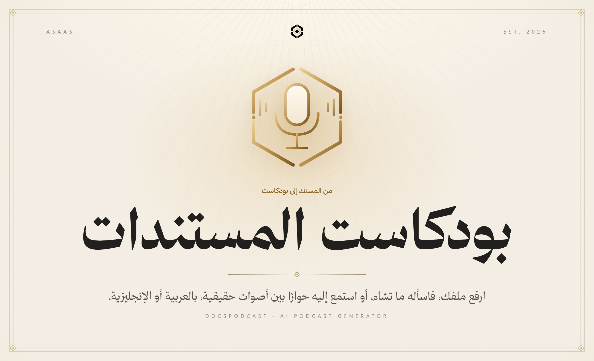
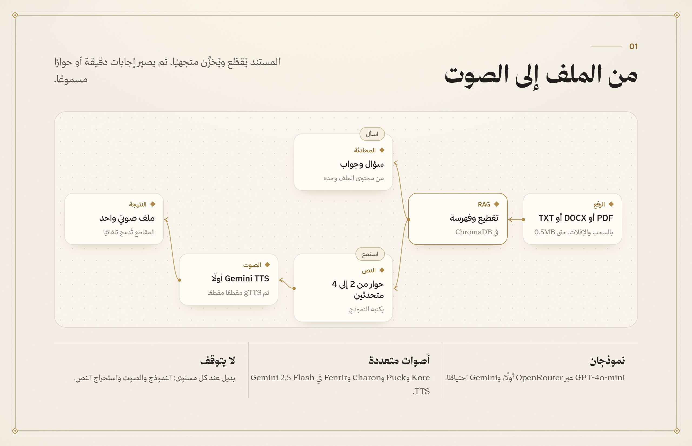
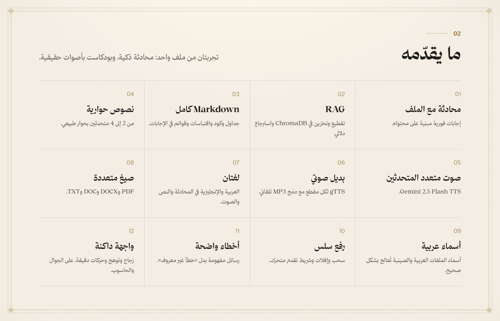
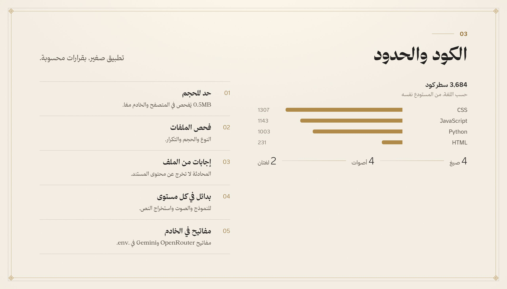
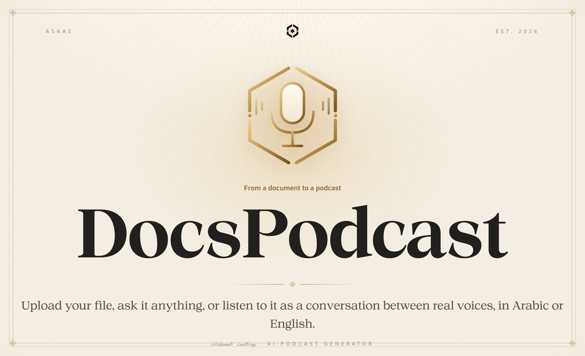
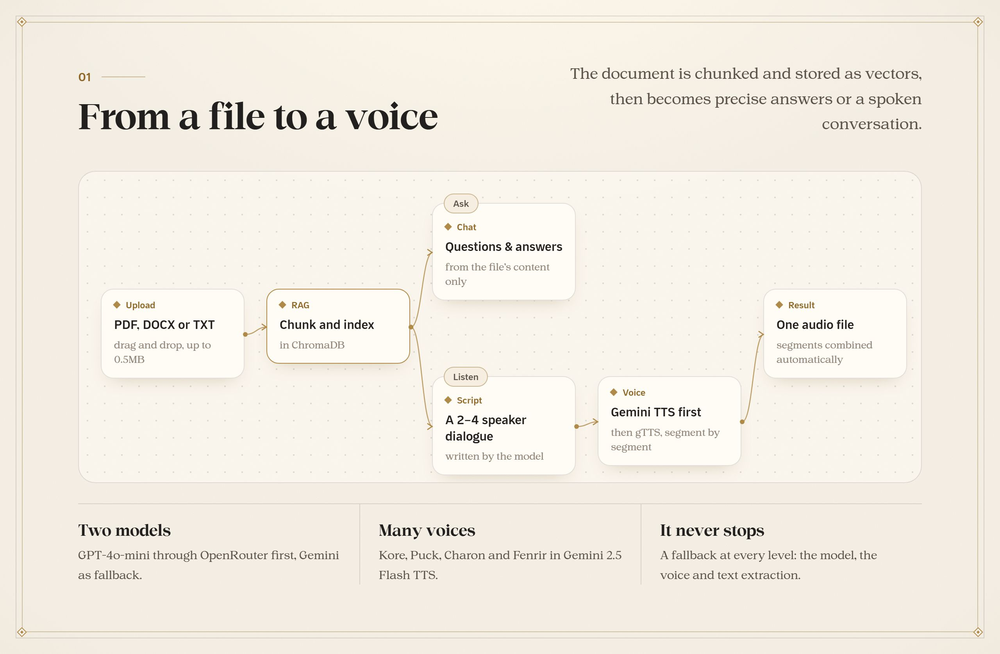
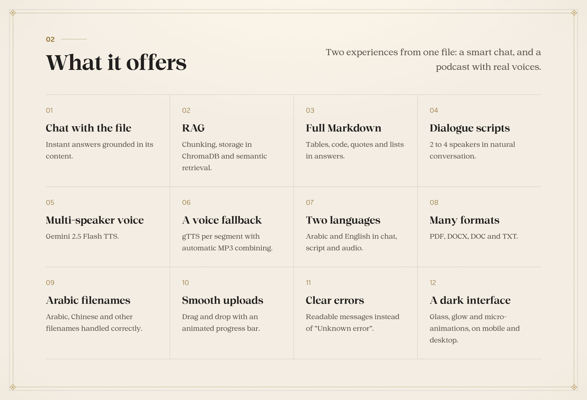
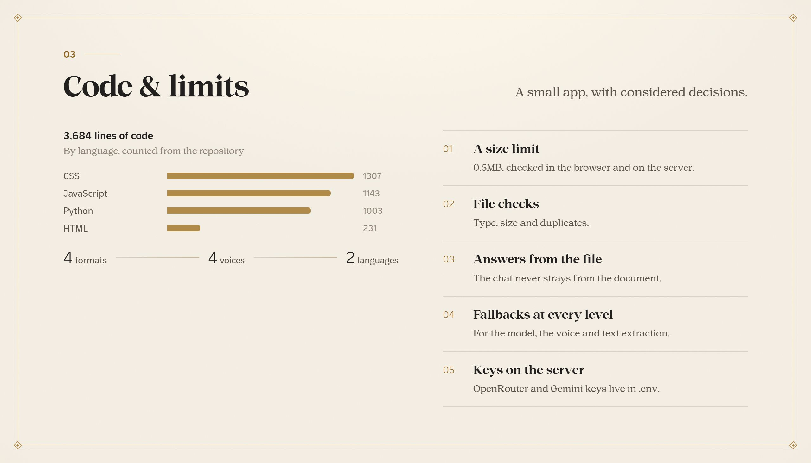

<a name="arabic"></a>

<p align="center"><b>العربية</b> · <a href="#english">English</a></p>



<br>

<div dir="rtl">

تطبيق ذكاء اصطناعي يحوّل مستنداتك إلى تجربتين: محادثة تجيب عن أي سؤال من محتوى الملف وحده، وبودكاست يحوّله إلى حوار بين متحدثين بأصوات حقيقية. خلفه RAG على ChromaDB، ونموذجان يتناوبان، وطبقتان للصوت، بالعربية والإنجليزية.

</div>

<br>







<br>

<div dir="rtl">

## التشغيل

```bash
python -m venv venv
venv/Scripts/pip install -r requirements.txt
# OPENROUTER_API_KEY وGEMINI_API_KEY في .env
python app.py
```

الدليل الكامل بالإنجليزية في [`docs/GUIDE.md`](docs/GUIDE.md).

</div>

<p align="center"></p>

<a name="english"></a>

<p align="center"><a href="#arabic">العربية</a> · <b>English</b></p>



<br>

An AI app that turns your documents into two experiences: a chat that answers any question from the file’s content alone, and a podcast that turns it into a conversation between speakers with real voices. Behind it: RAG on ChromaDB, two alternating models and two tiers of speech, in Arabic and English.

<br>







<br>

## Running it

```bash
python -m venv venv
venv/Scripts/pip install -r requirements.txt
# OPENROUTER_API_KEY and GEMINI_API_KEY in .env
python app.py
```

The full guide is in [`docs/GUIDE.md`](docs/GUIDE.md).

<p align="center"></p>

<p align="center"></p>

<p align="center">
  <sub>جزء من منظومة <b>أساس</b> · Part of the <b>Asaas</b> ecosystem</sub>
  <br>
  <sub>من تصميم وبناء <a href="https://github.com/AladdinAlynaey">علاء الدين اليناعي</a> · Designed and built by <a href="https://github.com/AladdinAlynaey">Alaadin Alynaey</a></sub>
  <br>
  <sub>© 2026 · جميع الحقوق محفوظة · All rights reserved</sub>
</p>
